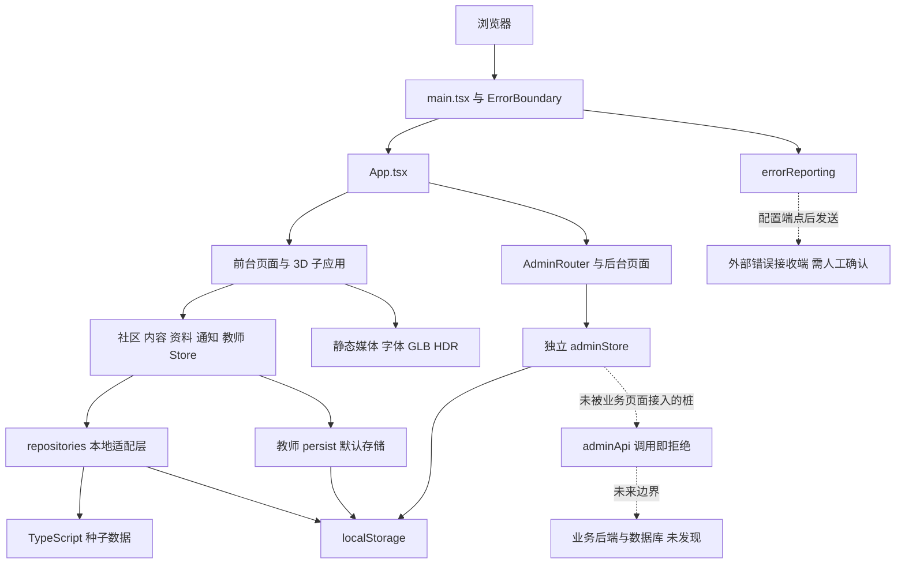
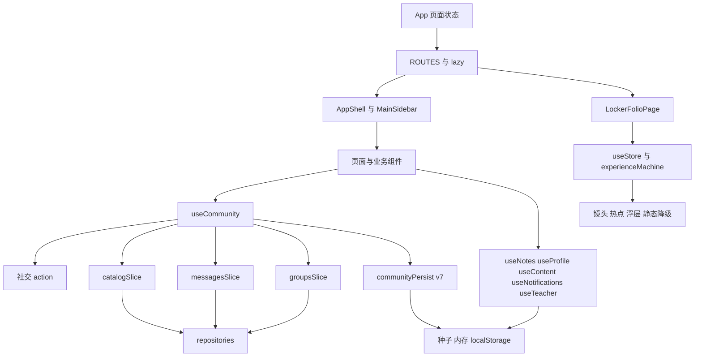
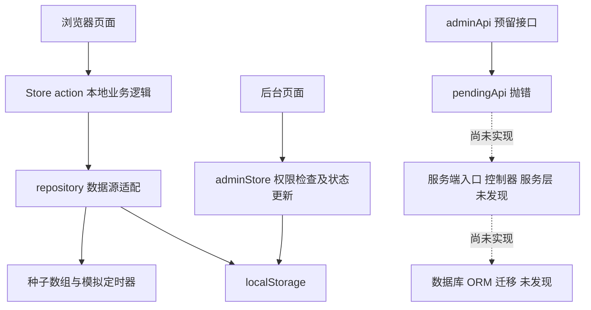
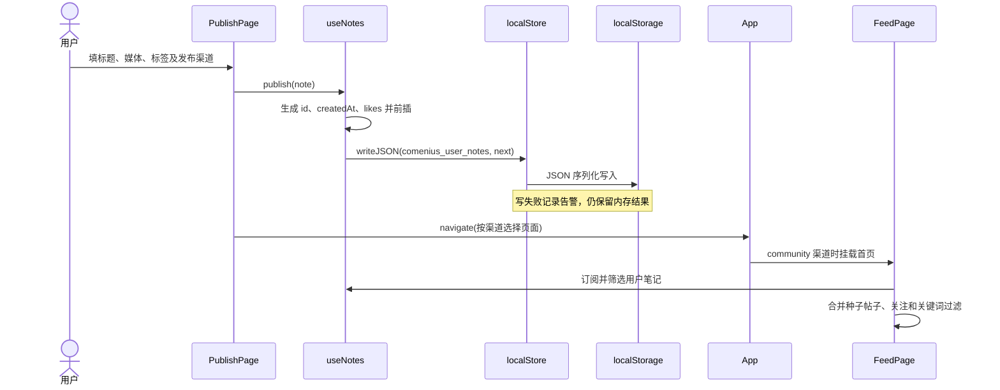
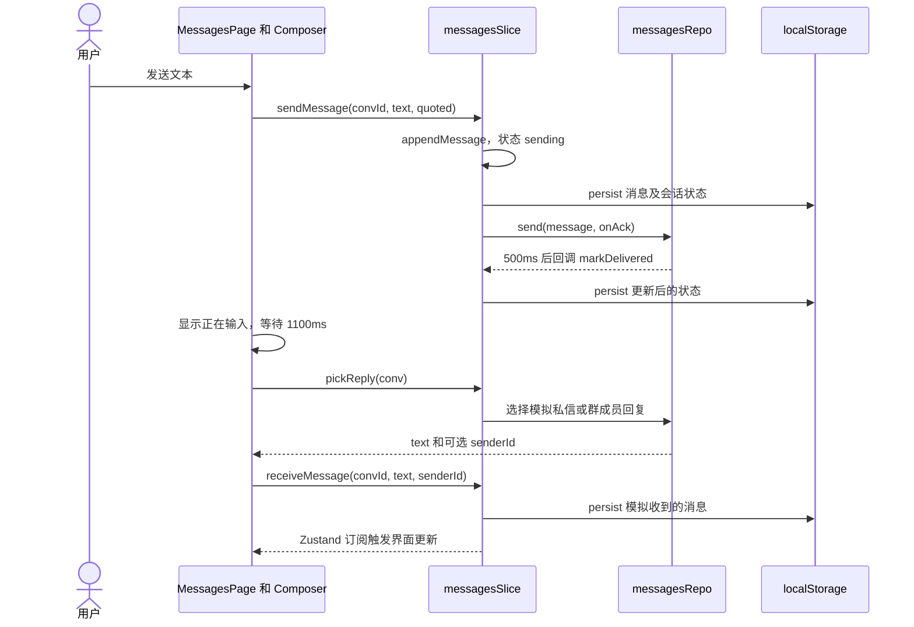
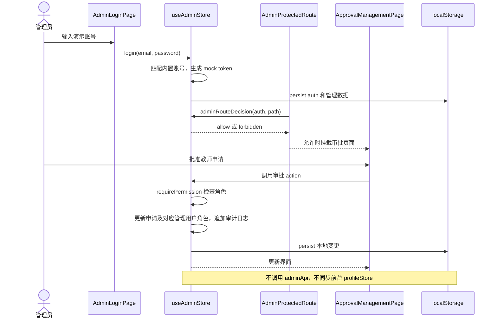
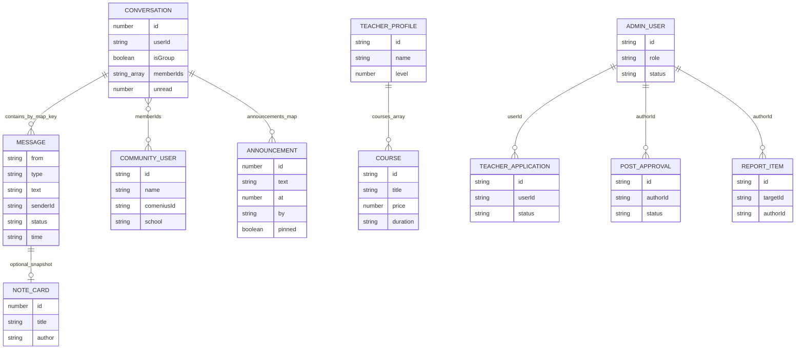

# 项目架构概览

> 分析日期：2026-10-03。依据当前仓库源码、配置和脚本；部署配置代表代码意图，未连接服务器验证运行状态。版本表使用 `package.json` 的声明范围，实际安装版本以 `pnpm-lock.yaml` 为准。本文件不将注释中的未来方案视为已经实现。

## 1. 项目简介

夸美纽斯 Comenius 是面向国际课程学生与教师的学习社区前端，提供内容发现与发布、个人档案、私信和群聊、课程内容、教师工作台、管理后台及沉浸式 3D 展示。

技术栈为 React 19、TypeScript、Vite 8、Tailwind CSS v4、Zustand 与 Three.js/React Three Fiber；业务数据目前来自前端种子数据及浏览器 localStorage，未发现实际业务后端或数据库实现。

## 2. 技术栈

| 层级                 | 技术                                 | 版本                       | 用途                               |
| -------------------- | ------------------------------------ | -------------------------- | ---------------------------------- |
| 前端                 | React / React DOM                    | ^19.3.0                    | 组件渲染、Hooks、懒加载            |
| 语言                 | TypeScript                           | ^5.7.0                     | 严格类型检查，TSX                  |
| 样式                 | Tailwind CSS / @tailwindcss/vite     | ^4.3.3                     | 工具类、主题与设计 token           |
| 状态                 | Zustand                              | ^5.0.15                    | 全局状态、slice、persist           |
| 动效                 | framer-motion / GSAP                 | ^13.4.3 / ^3.15.0          | 页面及 3D 体验动效                 |
| 3D                   | Three.js                             | ^0.185.1                   | WebGL 场景                         |
| 3D React             | @react-three/fiber / drei            | ^9.7.0 / ^10.7.8           | Canvas、场景组件与辅助能力         |
| 物理与后处理         | @react-three/rapier / postprocessing | ^2.2.0 / ^3.0.5            | 3D 物理及效果                      |
| 图像处理             | @imgly/background-removal            | ^1.7.0                     | 浏览器图像抠图能力                 |
| 构建                 | Vite / @vitejs/plugin-react          | ^8.3.1 / ^6.1.1            | 开发、HMR、静态打包                |
| 工具链               | Node.js / pnpm                       | 22 / 10.34.3               | `.mise.toml` 固定工具版本          |
| 测试                 | Vitest                               | ^5.0.1                     | Store、repository、认证等单测      |
| UI 验证              | Playwright 系列                      | package.json 未固定        | 浏览器脚本；CI 动态安装 playwright |
| 代码质量             | Prettier / oxlint / knip             | ^3.9.9 / ^1.85.0 / ^6.38.0 | 格式、静态检查、死代码报告         |
| 提交规范             | Husky / lint-staged / commitlint     | ^9.1.7 / ^17.5.1 / ^21.2.3 | Git 钩子与 Conventional Commits    |
| 数据层               | localStorage、内存及 TS 种子数组     | 浏览器内置                 | 本机持久化与模拟目录               |
| 后端、数据库、中间件 | 未发现                               | —                          | Strapi 等仅为注释或预留接口        |
| 部署                 | Figma Make；SSH + nginx 静态托管     | 未声明                     | `dist/` 发布、生产与 staging 切换  |

## 3. 目录结构

```text
./
├── package.json / pnpm-lock.yaml / pnpm-workspace.yaml  # 依赖、脚本和锁文件
├── .mise.toml / .npmrc                                # Node、pnpm 与安装行为
├── index.html                                        # HTML 壳、root 挂载点
├── vite.config.ts                                    # Vite、Tailwind、Figma 插件
├── tsconfig.json                                     # strict、别名、无输出类型检查
├── vitest.config.ts / vitest.setup.ts                 # Node 测试环境与本地存储替身
├── .prettierrc / .prettierignore / .oxlintrc.json      # 格式与 lint
├── knip.json / commitlint.config.cjs                  # 死代码与提交规范
├── AGENTS.md / CLAUDE.md / CONTRIBUTING.md            # 开发协作约定
├── README.md / README-交付说明.md                     # 说明及历史交付日志
├── ARCHITECTURE.md                                   # 本次代码核对后的架构说明
├── deploy.sh / 启动网站.command                      # 静态发布与本地启动
├── .figma/make/                                      # 站点元信息、开发与发布脚本
├── .github/workflows/                                # CI、staging 发布、健康监控
├── .github/ISSUE_TEMPLATE/ / CODEOWNERS               # 协作模板和归属
├── .husky/                                          # pre-commit、pre-push、commit-msg
├── docs/                                            # 既有架构、部署、技术债、仓库配置
│   └── adr/                                         # 7 项架构决策及索引
├── scripts/                                         # 冒烟、布局、E2E、视觉及质量门禁
│   ├── lib/                                         # 浏览器与视觉验证工具
│   ├── visual/                                      # 视觉基线
│   └── fonts/                                       # 中文字体获取与裁剪
├── src/
│   ├── main.tsx / App.tsx                            # React 启动、页面挂载及后台分流
│   ├── index.css / styles/ / assets/fonts/           # 设计 token、自托管字体和样式
│   ├── app/                                         # 路由、开关、异常边界与错误上报
│   ├── components/                                  # AppShell、MainSidebar、DemoNav
│   │   ├── ui/                                      # Button、Input、Switch 等基础控件
│   │   └── admin/                                   # 后台布局、权限守卫与 UI
│   ├── pages/                                       # 社区、发布、内容、教师等页面
│   │   ├── feed/                                    # 信息流卡片、灯箱、媒体及常量
│   │   ├── messages/                                # 会话列表、输入器、群面板等
│   │   └── admin/                                   # 后台路由、登录、审批、用户、日志、设置
│   ├── communityStore.ts / stores/community/         # 社区互动、消息、群管理和持久化
│   ├── notesStore.ts / profileStore.ts               # 发布笔记与个人档案
│   ├── contentStore.ts / notificationStore.ts        # 内容目录、通知与已读状态
│   ├── teacherStore.ts / adminStore.ts               # 教师工作台与独立后台模拟数据
│   ├── repositories/                                # 本地数据源边界、存储及错误策略
│   ├── data/posts.ts / community/data.ts             # 帖子、用户、消息、会话种子及类型
│   ├── blogData.ts / podcastData.ts / teacherData.ts  # 内容与教师种子模型
│   ├── notificationData.ts / blogCuration.ts         # 通知种子及文章整理逻辑
│   ├── teacher/ / profile/                           # 教师动态、人脉与职业档案 UI
│   ├── tedclone/                                    # Podcast 所用 TED 风格组件
│   ├── feed/ranking/                                # 推荐过滤、类型和权重骨架
│   ├── lockerfolio/                                 # 独立懒加载 3D 储物柜体验
│   │   ├── experience/                              # 状态机、时钟、编排、资源清单
│   │   ├── scene/                                   # 镜头、物理物件、热点、性能控制
│   │   └── components/                              # 加载、浮层、作品视图、静态降级
│   ├── forest/                                      # 森林场景与滚动动画体验
│   └── scripts/assets/                              # 材质、贴纸、图集等资产生成脚本
├── public/                                          # 原样复制到产物的静态资源
│   ├── models/                                      # GLB、HDR、素材署名
│   ├── stickers/                                    # PNG 贴纸
│   └── assets/                                      # 海报、摄影、封面、物件等 WebP
├── dist/                                            # 已存在的构建产物，非源码事实来源
└── node_modules/                                    # 已安装依赖
```

根目录与全仓文件清单中未发现 `pom.xml`、`go.mod`、`requirements.txt`、Dockerfile、docker-compose 配置、数据库迁移目录或业务服务端入口；隐藏目录中的构建/开发工具不能等同于业务后端。

## 4. 整体架构图



前端没有已实现的“业务 HTTP → 后端控制器 → 数据库”链路。页面主要调用 Store action，Store 从 repository 获取种子或更新本地状态。管理员数据与前台社区数据为两套独立模型，未发现共同服务或同步机制。

实际网络行为包括静态媒体和 3D 资源加载、可选的错误上报；资源清单与作品海报中的 `fetch` 用于获取资源，不是业务 API。字体获取脚本的 `fetch` 是开发工具行为。

## 5. 前端架构

### 5.1 启动与路由

`index.html → src/main.tsx → ErrorBoundary → App`。启动时安装全局 `error`、`unhandledrejection` 处理器，React StrictMode 下挂载应用。

前台路由为 `App.tsx` 的 `useState<PageName>('feed')`，`navigate(page, query)` 更新页面和查询词，通过 `src/app/routes.ts` 的 `ROUTES` 渲染。未使用 React Router，也未将前台页面状态同步到 URL/history；刷新后默认回到 feed。首页同步导入，其余 23 个前台页面懒加载，共 24 个路由键。

| 分组       | 路由键                                                                                         | 页面职责                              |
| ---------- | ---------------------------------------------------------------------------------------------- | ------------------------------------- |
| 社区       | feed、detail、profile、userProfile、search                                                     | 瀑布流、详情、本人/他人主页、搜索     |
| 发布与账号 | publish、write、login                                                                          | 多类型发布、写想法、模拟登录          |
| 沟通       | messages、notifications                                                                        | 私信、群聊、通知                      |
| 内容与探索 | amos、tutor、school、podcast、blog、frankscie                                                  | 模拟 AI、教师动态、学校、音视频与文章 |
| 教师工作台 | teacherHome、teacherCalendar、teacherCourses、teacherStudents、teacherEarnings、teacherProfile | 概览、排课、课程、学生、收入、资料    |
| 沉浸体验   | locker、forest                                                                                 | 3D 储物柜及森林滚动体验               |

后台由 `App.tsx` 检查原始 pathname 是否为 `/admin` 或 `/admin/…` 后分流；`AdminRouter` 使用 pushState/replaceState 和 popstate。路径为 `/admin/login`、`/admin`、`/admin/users`、`/admin/approvals`、`/admin/content`、`/admin/reports`、`/admin/logs`、`/admin/settings`。权限守卫决定登录重定向、允许访问或 403；后台入口按模块懒加载，但模块内页面为静态导入。

### 5.2 组件与状态

`AppShell + MainSidebar` 提供常规站内布局；`DemoNav` 默认开启。消息页拆为 Composer、ConversationList、GroupPanel、MemberList、AnnouncementsPanel、HistorySearchPanel、GroupQrCard 等。信息流拆为 cards、PostLightbox 与媒体辅助模块。

跨页面状态用 Zustand；表单、弹窗、教师动态和人脉等局部状态用 React Hooks。教师动态子应用 `teacher/TeacherApp.tsx` 的 posts、connections 为组件内 useState，身份来自 `useProfile`。教师工作台另用 `useTeacher`，不是同一份状态。



### 5.3 API 与 3D 边界

`repositories/postsRepo.ts`、`contentRepo.ts`、`usersRepo.ts`、`conversationsRepo.ts`、`notificationsRepo.ts` 返回本地种子；`messagesRepo.ts` 用定时器返回回执及模拟回复。统一 HTTP 客户端、业务 API base URL、WebSocket 连接均未发现。

`adminStore.ts` 中 `adminApi` 列出未来 Strapi REST 边界，例如 GET `/api/users`、`/api/teacher-applications`、`/api/posts`、`/api/reports`、`/api/audit-logs`，更新用户/审批/帖子、处理举报与密码重置、保存 `/api/admin-setting`。所有接口当前调用 `pendingApi` 抛出“尚未接入 Strapi”；业务页面使用本地 Store，未调用这些桩。Strapi 5 的 documentId 仅见接入注释，未发现服务端依赖与配置。

储物柜通过 `LockerFolioPage → lockerfolio/App → HeroSceneCanvas` 接入，`experienceMachine` 为状态事实来源，旧 `phase` 是派生兼容值。ExperienceOrchestrator 协调时钟、镜头及偏好，OverlayHost 管理浮层、焦点和退出动画，capabilities 检测设备并提供静态降级。资源清单负责加载与缓存相关行为，场景 Store 未配置 persist。

## 6. 后端架构

未发现业务服务启动入口、HTTP 控制器、服务端服务层、数据库数据访问层、ORM、数据库连接配置或迁移文件。Vite middleware 用于 robots.txt、Figma Kit 及开发辅助，不处理社区业务。

当前最接近分层后端的结构实际运行于浏览器：页面相当于交互入口、Store action 承担本地业务状态更新、repository 隔离数据源、种子与 localStorage 存放数据；这些不是服务器模块。



README 提及另一初版中的 Postgres、PostgREST、Fastify、MinIO 和迁移，且说明尚未并入。本仓库无对应实现，不能列为现有技术栈。该方案与管理员 Strapi 接入注释是否统一，需人工确认。

## 7. 核心业务流程

### 7.1 发布笔记并进入内容页

`PublishPage` 根据 image/video/article/podcast 组装 UserNote，并按 channels 跳转。图片封面用 FileReader 得到 Data URL；视频得到临时 Blob URL。首页仅合并 channels 包含 community 的用户笔记与种子帖子。



### 7.2 私信发送、模拟回执与模拟回复



本流程不发送网络消息；回执并非服务器确认，回复并非真实用户发送。

### 7.3 管理员登录与教师审批



## 8. 数据模型

### 8.1 存储布局

未发现真实数据库表或集合；以下是浏览器存储键及 TypeScript 领域对象。

| 存储键/来源            | 数据                                                                  | 说明                                                         |
| ---------------------- | --------------------------------------------------------------------- | ------------------------------------------------------------ |
| comenius_community     | 社交状态、会话、消息、群设置、公告、管理员/群主、入群申请等           | persist v7；白名单 partialize/merge；posts、成员目录等不落盘 |
| comenius_user_notes    | UserNote[]                                                            | 普通 JSON；生成 id、createdAt、likes；无显式 schema 版本     |
| comenius_profile       | ProfileData                                                           | persist v1；社区与职业面共用                                 |
| comenius_notifications | readKeys、settings                                                    | persist v1；通知目录不落盘                                   |
| comenius_teacher       | myProfile、lessons、students、orders                                  | persist；默认 storage，没有显式版本                          |
| comenius-admin-mock-v1 | auth、用户、申请、内容审批、举报、日志、设置                          | persist v1；独立管理模型                                     |
| comenius_flags         | 功能开关覆盖                                                          | 普通 JSON；URL 参数优先                                      |
| TS 种子数组            | Post、User、Conversation、Message、BlogPost、PodcastEpisode、Notif 等 | 模块导入；部分随后进入 Store                                 |
| 组件内存/场景 Store    | 教师动态、人脉、AI 对话、3D 体验状态等                                | 未发现统一持久化                                             |

### 8.2 主要实体关系

下图表示代码对象包含和引用关系，不表示数据库外键。Message 没有独立 id，其所在 messages[convId] 数组提供会话归属；UserNote.author 和 Post.author 是名称文本，不能画成可靠 userId 外键。群成员用 memberIds 引用用户；公告由 announcements[convId] 归属会话。



Post 与 UserNote 支持 image/text/video/article/podcast；UserNote 另含 channels、category、createdAt。社区评论为 comments[postId] 中的姓名、文本和时间对象；点赞/收藏为帖子 id 数组，关注为用户 id 数组。ProfileData 包含角色、身份、学术记录、职业经历、教育、技能、项目与贴纸。

TeacherStore 的 Lesson、Student、Order 用 studentName/courseTitle 等字符串关联，未建立 courseId/studentId 外键；simulatePurchase 本地生成三类对象，金额为课程价格乘 10，并标记已支付，不存在支付网关。管理员 AuditLog 为独立本地审计记录；举报 targetId 的含义取决于举报类型，未发现统一目标实体表。

缓存：已发现浏览器资源缓存、内存状态、资源请求中的 force-cache；未发现 Redis 等服务端缓存。消息队列与消息中间件未发现；定时器模拟聊天不等于消息队列。

## 9. 模块职责说明

| 模块          | 路径                                                                | 职责                                        | 依赖                                   |
| ------------- | ------------------------------------------------------------------- | ------------------------------------------- | -------------------------------------- |
| 启动与异常    | src/main.tsx、src/app/ErrorBoundary.tsx、src/app/errorReporting.ts  | 挂载、渲染兜底、全局异常及可选上报          | React、浏览器 API                      |
| 导航          | src/App.tsx、src/app/routes.ts、src/app/flags.ts                    | 前台状态路由、后台分流、功能开关            | React lazy、页面模块                   |
| 公共布局      | src/components/AppShell.tsx、MainSidebar.tsx、DemoNav.tsx           | 侧栏、内容区、演示跳板                      | NavProps、资料/通知等 Store            |
| 信息流        | src/pages/FeedPage.tsx、src/pages/feed/                             | 聚合笔记、筛选、卡片与详情灯箱              | useCommunity、useNotes、framer-motion  |
| 发布          | src/pages/PublishPage.tsx、WriteThoughtsPage.tsx、src/notesStore.ts | 编辑与本地发布                              | useContent、localStore、浏览器文件 API |
| 社区与群聊    | src/communityStore.ts、src/stores/community/、src/pages/messages/   | 社交互动、会话收发、群治理和迁移            | Zustand、repositories、种子模型        |
| 数据适配      | src/repositories/                                                   | 种子入口、模拟回执、本地存储与失败语义      | TS 数据文件、localStorage              |
| 资料          | src/profileStore.ts、src/profile/、src/pages/ProfilePage.tsx        | 社区与职业资料编辑                          | persist、职业数据类型                  |
| 通知          | src/notificationStore.ts、src/pages/NotificationPage.tsx            | 分类目录、已读、提醒设置                    | notificationsRepo、persist             |
| 内容目录      | src/contentStore.ts、BlogPage.tsx、PodcastPage.tsx、src/tedclone/   | 文章与音视频分类、内容展示                  | contentRepo、useNotes、种子内容        |
| 教师社交      | src/pages/TeacherPage.tsx、src/teacher/                             | 动态、人脉、本地互动                        | useProfile、组件 useState              |
| 教师工作台    | src/teacherStore.ts、src/pages/Teacher*Page.tsx                     | 课程、排课、学生、模拟订单及收入            | teacherData、persist                   |
| AI 与账号演示 | src/pages/AmosAIPage.tsx、LoginPage.tsx                             | 模拟对话、验证码与登录交互                  | Hooks、定时器                          |
| 管理后台      | src/pages/admin/、src/components/admin/、src/adminStore.ts          | 独立 URL 路由、角色守卫、管理与本地审计     | Zustand、history、localStorage         |
| 推荐骨架      | src/feed/ranking/                                                   | 类型、过滤规则、权重初值                    | 尚未接入首页                           |
| 储物柜        | src/lockerfolio/                                                    | 资源加载、状态机、镜头/热点、作品浮层、降级 | Three、R3F、drei、rapier 等            |
| 森林体验      | src/forest/                                                         | 加载与随滚动推进的场景                      | React、framer-motion、ForestScene      |
| 工程质量      | scripts/、.github/workflows/、.husky/                               | 自动验证、门禁、发布与监控                  | pnpm、浏览器工具、SSH                  |

## 10. 关键配置与环境

### 10.1 环境变量

| 变量                                         | 来源                      | 默认值/作用                                                  |
| -------------------------------------------- | ------------------------- | ------------------------------------------------------------ |
| PORT                                         | vite.config.ts            | 8443；dev strictPort，preview 同样读取                       |
| FIGMA_PUBLIC_URL                             | vite.config.ts、deploy.sh | 未设置时 base=/；发布时设 /community 或 /staging，再追加斜杠 |
| VITE_ERROR_ENDPOINT                          | src/app/errorReporting.ts | 未配置则不发送上报；构建时注入外部接收地址                   |
| DEPLOY_HOST、SSH_KEY、KEEP                   | deploy.sh                 | 默认部署主机、本机 SSH 密钥路径、保留 5 个 release           |
| DEPLOY_SSH_KEY                               | GitHub Actions Secret     | staging 部署密钥；不存在时跳过发布                           |
| SMOKE_BASE                                   | scripts/lib/browser.mjs   | 默认 http://localhost:8443/；CI 使用 4173 或 staging         |
| CHROME_PATH、PLAYWRIGHT_CORE                 | scripts/lib/browser.mjs   | 可指定浏览器与工具模块                                       |
| DIST_DIR、INITIAL_BUDGET_KB、CHUNK_BUDGET_KB | scripts/bundle-budget.mjs | dist、200、900；包体预算参数                                 |

未发现 `.env` 示例、业务 API 地址、数据库 URL、Redis 或消息队列连接变量。`import.meta.env.DEV/BASE_URL` 为 Vite 内置值。功能开关优先级为 URL `?flag=` > comenius_flags > 默认值；demoNav=true、ranking=false，模块加载时读取。

### 10.2 配置及质量体系

Vite 设置 @ 别名、React/Tailwind 插件及本地 Figma 插件：站点 HTML/robots 注入、错误浮层重放、Refresh 边界降级和开发 Kit。development 模式构建输出 inline sourcemap 且关闭压缩；普通构建不输出 sourcemap。

`.figma/make/site.json` 设置中文站名、zh-CN、内嵌 favicon、禁止索引；`src/index.css` 与 fonts-cjk.css 负责 token 和字体，自托管资源放于字体包及 src/assets/fonts。TypeScript strict=true，noEmit=true。Vitest 使用 Node 环境和内存 localStorage 替身，重点覆盖 Store、迁移、模拟消息、管理认证与错误上报。

`pnpm check` 依次执行类型、单测、lint、格式、路由、文件规模、工作流、token、构建、预算检查。CI 另包括依赖审计、非阻断 deadcode 报告以及 UI 冒烟/布局/E2E/视觉验证。本次为文档任务，没有执行整套应用验证，也不引用历史包体或漏洞数为当前实测结果。

### 10.3 部署与 CI/CD

1. Figma Make：`.figma/make/deploy` 构建 dist 后调用 figma make deploy；deploy-preview 用 development 模式构建再发布预览。
2. nginx 静态托管：`deploy.sh` 按目标设置 base，构建、tar 打包、scp 上传，写入 releases/北京时间时间戳，软链切换并清理旧版本。生产子路径 /community/，staging 为 /staging/；服务器根目录分别为 /opt/community-web、/opt/community-web-staging。脚本提供 rollback 分支并进行 HTTP 200 检查。
3. `.github/workflows/ci.yml` 并行执行静态、构建与 UI 检查，含 main 提交关联 PR 自查。该自查发生在推送之后，不是服务端分支保护。
4. deploy-staging.yml 独立监听 main push 和手动触发，检查 Secret 后部署并冒烟；未发现其等待 CI workflow 成功的依赖。
5. monitor.yml 每小时检查生产/staging HTTP、首页标题和证书剩余时间；HTTP 探测使用 curl -k，证书过期另行检测。

服务器 nginx 实际配置、备份 cron、Secret 是否已设置、线上当前版本及分支保护状态需人工确认；README 的“已配置”不能由仓库独立证明。本次未执行部署、连接服务器或变更环境。

## 11. 发现的问题与建议

| 问题/证据                                                                                                   | 影响                                                          | 建议                                                                               |
| ----------------------------------------------------------------------------------------------------------- | ------------------------------------------------------------- | ---------------------------------------------------------------------------------- |
| 未实现业务后端；repository 返回种子，聊天回执与 AI/验证码由定时器模拟                                       | 不支持真实跨用户协作、跨设备同步或服务端鉴权                  | 明确演示范围；选定后端方案并逐条接入真实请求、失败处理与身份模型                   |
| adminStore 内置演示凭据、生成 mock token，权限判断在浏览器                                                  | 无法承担生产安全边界；本地角色和数据可被修改                  | 接入服务端认证、授权与审计，移除生产包中的演示账号                                 |
| 后台管理数据独立于 communityStore/profileStore/notesStore                                                   | 审批、禁言、内容处理不改变前台真实社区状态                    | 后端整合用户和内容主数据；定义同步与审批状态                                       |
| App 和 AdminRouter 使用绝对 /admin pathname，deploy.sh 发布到 /community/ 或 /staging/                      | /community/admin 不能命中后台；/admin 又可能脱离静态站点 base | 统一 basename 与 history 导航，增加子路径和刷新验收，并核对 nginx fallback         |
| PublishPage 保存 URL.createObjectURL 的视频地址，未发现对应 revokeObjectURL                                 | 刷新后临时地址不可恢复，重复选文件可能累积资源                | 上传对象存储或将 Blob 存 IndexedDB；管理对象 URL 生命周期                          |
| PublishPage 的 saveDraft 仅显示“已存为草稿（演示）”；visibility 未进入 UserNote                             | 草稿未保存，可见性不是实际权限                                | 实现草稿模型；保存可见性并由服务端执行访问控制                                     |
| 本地存储边界注释称“全仓唯一”，但 flags/adminStore 直接调用 localStorage，teacherStore 使用 persist 默认存储 | 存储异常策略、迁移和可观测性不一致                            | 收敛适配器或在 ADR 明确例外                                                        |
| localStore 写失败保持乐观结果，reportRepoError 只在 dev 告警                                                | 用户可能误认为内容已持久化，生产缺少该错误的反馈              | 增加可恢复提示与统一错误上报，保留明确的保存状态                                   |
| communityPersist 针对旧版本分支提前返回                                                                     | 一次迁移可能只补一个阶段字段，未显式串行运行全部后续迁移      | 逐版本串行迁移并覆盖跨多版本升级场景；现有 merge/defaults 不能代替完整 schema 校验 |
| profileStore 的低版本 migrate 返回 DEFAULT_PROFILE                                                          | 旧版本个人资料可能被重置                                      | 用旧字段与默认值合并并添加保留用户资料的升级验证                                   |
| notesStore 使用 Date.now() 作 id；Message 无独立 id，操作以数组位置定位                                     | 快速发布可能碰撞；真实异步回执与删除/撤回难以稳定定位         | 使用稳定 UUID 或服务端 id，回执按 messageId 更新                                   |
| TeacherStore 课程/学生/订单靠名称关联，订单来自 simulatePurchase                                            | 重名及改名关系不可靠，“已支付”不能作为财务证据                | 使用实体 id 和服务端订单/支付状态机                                                |
| ranking=false，首页未调用 ranking 模块                                                                      | 权重与过滤骨架不代表已上线推荐算法                            | 接入前补齐输入契约、排序实现和效果验证                                             |
| DemoNav 默认 true，生产也会渲染                                                                             | 演示入口仍属于正式 UI                                         | 产品确认正式入口后关闭或移除临时开关                                               |
| 3D assetManifest 的授权字段含 TODO 与 unverified/待确认                                                     | 部分资产授权未核实                                            | 逐项补来源和授权证据，与 public/models/ASSET_CREDITS.md 对照                       |
| lockerfolio/store 的 closeOverlay 立即发送 OVERLAY_EXITED，注释说明宿主尚未回报阶段                         | 状态机阶段与实际退出动画存在兼容折中                          | 由 OverlayHost 动画完成事件推进退出阶段                                            |
| README 写其余 19 页懒加载，实际前台为 24 页；写 App 是路由表，而表已在 app/routes.ts                        | 页面规模与职责描述过时                                        | 更新 README 和既有 docs/ARCHITECTURE.md，明确本文件与旧文档的维护关系              |
| README 巨型文件统计过时：当前 FeedPage 718 行、TeacherApp 707 行、MessagesPage 1453 行                      | 已完成拆分被误认为仍未完成                                    | 用当前统计更新技术债；继续按职责拆消息页                                           |
| community/data.ts 注释说 POSTS 位于 FeedPage，实际为 data/posts.ts                                          | 数据源定位错误                                                | 修正过时注释；使用 repository 作为入口                                             |
| AGENTS.md 写 oxfmt，但 package.json 和 ADR-0001 使用 Prettier                                               | 开发约定与执行工具不一致                                      | 统一协作指南，以实际脚本及 ADR 为依据                                              |
| README 提及未入仓 Postgres/Fastify 方案，adminApi 注释预留 Strapi                                           | 后端方向不明确                                                | 人工确认目标并补 ADR；不要将任一方案记为当前实现                                   |
| staging 发布独立于 CI；CI 动态 pnpm add playwright                                                          | 检查未完成也可能发布；浏览器工具版本不固定                    | 发布等待必要门禁，固定验证工具版本及安装方式                                       |
| deploy release 时间戳精度为分钟，回滚按目录排序取第二个版本                                                 | 同分钟发布可能复用目录；连续回滚不一定继续向更早版本推进      | 使用提交 SHA/秒级 id，记录当前版本并按当前指针选择上一版本                         |

明确未发现：业务数据库、服务端缓存、消息队列、真实支付、真实短信/AI 服务接入、容器编排、数据库迁移。需人工确认：最终后端选型、线上基础设施状态、素材授权及正式产品入口。项目已有 docs/ARCHITECTURE.md、部署 Runbook 与 ADR，问题主要是部分说明未随代码更新，而不是完全没有文档。
